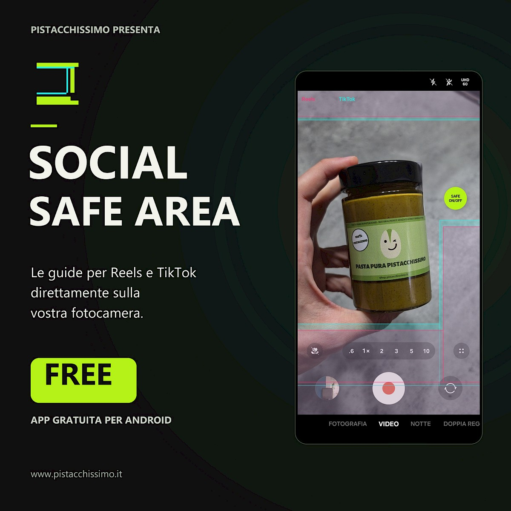

# Social Safe Area — Camera overlay for Reels and TikTok

[English](README.md) · [Italiano](README.it.md)



Una maschera leggera per Android che ti aiuta a tenere volti, scritte e dettagli importanti lontani dagli elementi dell’interfaccia di Instagram Reels e TikTok.

**v1.4.0 · Android 8.0+ (API 26) · GPL-3.0-only**

I sorgenti attuali preparano la **1.4.1**, una bozza Google Play non pubblicata: target API 36, link alla privacy e consenso esplicito per il rilevamento fotocamera facoltativo. Vedi [preparazione e verifiche per Play](docs/google-play.md).

Sul telefono l’app si chiama **Safe Area**. Il nome preparato per Google Play è
**Safe Area: Reels & TikTok**; la distribuzione su Google Play non è ancora disponibile.

[](https://github.com/MarcorOnline/SocialSafeArea/releases/download/v1.4.0/Social-Safe-Area-1.4.0.apk)

**Non serve compilare:** scarica l’APK firmato, aprilo sul telefono e segui le istruzioni di installazione di Android. Consulta le [note di rilascio e i checksum](https://github.com/MarcorOnline/SocialSafeArea/releases/tag/v1.4.0).

L’app disegna una guida trasparente sopra la fotocamera che usi già. Non registra video, non sostituisce la fotocamera e non modifica il file registrato. La guida compare sullo schermo del telefono, ma non viene impressa nelle registrazioni della fotocamera.

## Perché ho creato quest’app

Sono Marco Rinaldi, il creatore di [Pistacchissimo](https://www.pistacchissimo.it/). Social Safe Area nasce dalle mie esigenze quando giro contenuti per Pistacchissimo. Ho scelto di renderla gratuita e open source per condividerla con la community.

Se l’app ti è utile, puoi sostenere il mio lavoro [seguendo @pistacchissimo su Instagram](https://www.instagram.com/pistacchissimo/) o [scoprendo lo shop Pistacchissimo](https://shop.pistacchissimo.it/).

## Funzioni

- Tre checkbox indipendenti e salvati: **Reel** (rosa), **TikTok** (turchese) e **Sottotitoli** (azzurro). Alla prima installazione sono attivi solo Reel e TikTok; è possibile spegnere anche tutte le maschere.
- Un rettangolo per i sottotitoli centrato sullo schermo, inizialmente poco sopra la fascia inferiore di TikTok. Condivide opacità e posizione generale delle guide, con una regolazione verticale aggiuntiva salvata da −720 a +720 dp per spostare solo il box, anche verso l’alto.
- Fasce da evitare in alto, in basso e nella parte inferiore destra, secondo il modello di riferimento; l’area utile per la composizione resta libera.
- Un piccolo **bottone rapido** trascinabile con la scritta `SAFE / ON/OFF`, la cui posizione viene salvata tra una sessione e l’altra.
- Opacità della maschera dall’8% al 70%, con valore predefinito del 23%.
- Profili per dispositivo, versione Android e fotocamera, con selezione del più simile, più regolazione verticale manuale da −360 a +360 dp. **Reset** ripristina il profilo suggerito.
- Visualizzazione automatica facoltativa quando si apre l’app selezionata, con scomparsa quando si passa a un’altra app o alla schermata Home.
- Dalla v1.1.0: controllo aggiornamenti settimanale all’apertura dell’app, con un link discreto quando è disponibile una nuova versione.
- La guida lascia passare i tocchi: i comandi della fotocamera restano utilizzabili.
- Interfaccia e servizi Android nativi, senza librerie di terze parti a runtime, account, pubblicità o analisi dell’utilizzo.

L’interfaccia supporta **inglese (predefinito e di riserva), italiano, francese, spagnolo e tedesco**. Segue la lingua del dispositivo; da Android 13 è anche possibile scegliere la lingua della singola app nelle impostazioni di sistema. Il pulsante **ⓘ** in basso apre i crediti, l’origine dell’app da un’idea di Pistacchissimo e il relativo articolo del blog, i profili Instagram @pistacchissimo e personale, i sorgenti del progetto, l’avviso GPLv3 e i dettagli della calibrazione.

## Primi passi

Scarica l’APK con il pulsante di download qui sopra. Android potrebbe chiederti di consentire l’installazione dal browser o dal gestore file: autorizza la sorgente che stai usando e poi apri l’APK. Puoi anche compilare l’app seguendo le istruzioni più avanti.

### Consenti la visualizzazione sopra la fotocamera

Apri **Safe Area** e tocca **Mostra bottone rapido**. Nella pagina dei permessi di Android, seleziona Safe Area e attiva **Mostra sopra altre app** / **Comparsa in primo piano**, poi torna all’app. Su Samsung lo stesso interruttore si trova in **Impostazioni → Applicazioni → Accesso speciale → Comparsa in primo piano**; i nomi possono variare in base alla versione di Android. Le versioni pubblicate prima della v1.1.0 si chiamano Social Safe Area.

Questo permesso serve per disegnare sopra la fotocamera. L’accessibilità è un permesso separato e facoltativo.

Le impostazioni sono raccolte in tre sezioni, **Personalizza maschera**, **Apertura automatica** e **Funzioni sperimentali**, inizialmente chiuse: aprendo una sezione si chiude la precedente. **Mostra bottone rapido** resta sempre disponibile in alto.

1. Apri **Personalizza maschera** e attiva o disattiva a piacere i checkbox **Reel**, **TikTok** e **Sottotitoli**.
2. Se necessario, regola **Opacità maschera** e **Posizione verticale generale**. Il relativo **Reset** ripristina l’allineamento predefinito del profilo rilevato. **Posizione verticale sottotitoli** sposta solo il box rispetto alla posizione generale; il suo **Reset** azzera lo scostamento aggiuntivo. Il cursore sottotitoli e il suo Reset sono disabilitati quando **Sottotitoli** non è selezionato, conservando la posizione salvata per la prossima attivazione.
3. Tocca **Mostra bottone rapido**. Questa azione mostra solo il bottone: premerlo più volte non cambia lo stato ON/OFF della maschera.
4. Usa il bottone flottante `SAFE / ON/OFF` per accendere o spegnere la maschera. Solo questo bottone cambia tale stato.
5. Trascina il bottone rapido per spostarlo. Per chiudere la maschera e il bottone, trascinalo sul cestino che compare in basso.

Aprire Safe Area ripristina anche il bottone rapido se il permesso di sovrapposizione è già concesso. La maschera scelta, l’opacità, l’allineamento verticale, la posizione del bottone e lo stato ON/OFF vengono salvati sul dispositivo.

### Segui automaticamente l’app fotocamera

1. Apri **Apertura automatica** e, in **Apri il bottone rapido quando apro**, seleziona la tua app fotocamera.
2. Tocca **Abilita rilevamento fotocamera**, leggi l'informativa e scegli **Continua nelle impostazioni Android** solo se vuoi usare questa funzione facoltativa. **Annulla** mantiene il controllo manuale senza aprire le impostazioni.
3. Cerca **Rilevamento app Safe Area** tra le app o i servizi installati/scaricati, attivalo e conferma la richiesta di Android.
4. Torna in Safe Area, poi apri la fotocamera selezionata.

Se Android blocca l’accessibilità per un’app installata tramite APK, potrebbe essere necessario abilitare **Informazioni app → ⋮ → Consenti impostazioni con limitazioni**. Fallo solo per una versione di cui ti fidi; consulta la [spiegazione di Android sulle impostazioni con limitazioni](https://support.google.com/android/answer/12623953). I nomi dei menu dipendono dal sistema e dal produttore.

Aprire l’app selezionata mostra il bottone rapido e ripristina lo stato salvato della maschera. Passare a un’altra app o alla Home nasconde sia il bottone sia la maschera. Tornare all’app selezionata li ripristina senza cambiare ON/OFF.

Chiudere esplicitamente la sovrapposizione con il cestino o con **Chiudi app** nella notifica sospende la riapertura automatica finché non riapri Safe Area. Seleziona **Nessuna app** per disattivare questa funzione.

Il rilevamento usa gli eventi di cambio finestra a schermo intero. Popup e pannelli parziali non vengono considerati un’uscita dalla fotocamera. Con la funzione sperimentale disattivata non viene letto il contenuto delle finestre.

### Mostra la maschera solo in modalità Video (sperimentale)

In **Funzioni sperimentali** puoi attivare **Mostra la maschera solo in modalità "Video"**,
spenta di default. Il pulsante **?** spiega funzionamento, accesso ai comandi e
limiti prima dell’attivazione. Richiede il rilevamento fotocamera e un profilo
esatto compatibile: quello iniziale supporta Samsung Camera in italiano, inglese,
francese, spagnolo e tedesco, in verticale, sul dispositivo e sulla versione
indicati nei profili.

La funzione legge localmente i comandi accessibili della fotocamera selezionata
in risposta agli eventi, senza screenshot né controlli periodici. In Fotografia
nasconde la guida mantenendo il bottone; in Video ripristina la scelta manuale
ON/OFF. Se la modalità non è riconosciuta, torna al controllo manuale dopo una
breve tolleranza alle transizioni. Non salva né invia il testo dei comandi e non
cambia lo stato ON/OFF salvato. Lingua, orientamento e aggiornamenti della
fotocamera possono influire sul riconoscimento. Consulta il [formato dei profili](docs/camera-profiles.md#experimental-camera-mode-detection).

### Notifiche

Quando la sovrapposizione è attiva, l’app usa un servizio Android in primo piano e prepara una notifica con il comando **Chiudi app**.

Da Android 13 l’app non richiede il permesso per le notifiche, quindi questa notifica potrebbe non comparire nel pannello notifiche. Il servizio può comunque restare attivo e compare nei controlli delle app attive di Android. Consulta la [documentazione di Android sui permessi per le notifiche](https://developer.android.com/develop/ui/views/notifications/notification-permission).

## Compatibilità e limiti attuali

Serve Android 8.0 o successivo. L’app è stata verificata su **Samsung Galaxy S26 Ultra (SM-S948B), Android 17 / API 37, Samsung Camera 17.0.00.43**, in verticale, con anteprima della fotocamera in **9:16**.

Il riferimento predefinito è uno schermo da 1080 × 2340 pixel con l’anteprima video effettiva in `x=0…1080, y=184…2104`: un fotogramma da 1080 × 1920 pixel. La maschera viene scalata in modo uniforme e il disegno tiene conto degli spostamenti della finestra Android. La densità viene usata per i comandi e per la regolazione verticale manuale.

Altri dispositivi, interfacce della fotocamera, rapporti d’aspetto e impostazioni dello schermo possono richiedere una regolazione verticale, anche quando viene suggerito un profilo simile. La guida resta fissa sul pannello fisico quando Android ruota, mantenendo scala e allineamento verticale salvato. Non individua automaticamente l’anteprima della fotocamera, non ne calibra larghezza e altezza e non offre una geometria separata per i video orizzontali. Android o singole app possono inoltre limitare le sovrapposizioni nelle schermate protette.

La maschera è un aiuto alla composizione basato su un riferimento fisso, non una garanzia ufficiale di posizionamento sicuro. Le interfacce di Reels e TikTok possono variare. Il progetto è indipendente e non è affiliato a Samsung, Instagram, Meta o TikTok.

## Aiuta a migliorare l’allineamento

Il contributo più utile della community è un **offset verticale corretto per le app fotocamera più diffuse**, verificato su un dispositivo reale.

I profili si trovano in un unico piccolo file: [`camera-profiles.json`](app/src/main/assets/camera-profiles.json). Ogni voce riporta produttore, modello, API Android, pacchetto/versione della fotocamera e offset in dp. Regola la maschera con il cursore, poi apri **ⓘ → Copia JSON della calibrazione** e invia la voce con una pull request verso **`develop`**.

All’avvio l’app rileva dispositivo, sistema operativo e fotocamera selezionata (o quella predefinita per i video). Suggerisce il profilo utilizzabile più vicino: prima lo stesso modello, poi l’API Android più vicina, infine app e versione della fotocamera. Se il modello è sconosciuto, cerca tra i dispositivi dello stesso produttore; per un produttore sconosciuto usa come predefinito il **primo profilo valido**. A parità di punteggio viene mantenuto l’ordine del file.

Le regolazioni manuali hanno sempre la precedenza e sopravvivono ai riavvii e agli aggiornamenti dell’app. **Reset** rimuove la regolazione manuale e torna al suggerimento attuale. Metadati mancanti, voci non valide e profili illeggibili o vuoti portano a valori di riserva sicuri, fino a 0 dp; un errore di rilevamento non impedisce l’apertura della guida.

Consulta [formato dei profili e regole di selezione](docs/camera-profiles.md) per esempi, priorità e istruzioni di verifica. I profili sono inclusi nell’app e funzionano offline: un contributo accettato diventa disponibile nella build successiva.

## Privacy e permessi

Dalla v1.1.0 l’app usa il permesso Internet per controllare direttamente l’ultima release stabile su GitHub quando apri la schermata dei comandi, al massimo una volta ogni sette giorni, anche se il tentativo fallisce. Non invia identificatori del dispositivo, calibrazioni, account o versione installata. GitHub e i suoi fornitori di rete ricevono i normali metadati di connessione, come l’indirizzo IP. Le versioni pubblicate in precedenza non hanno il permesso di accesso alla rete.

Se esiste una versione più recente, compare il pulsante **Vedi aggiornamento**, che apre GitHub solo al tocco. Non ci sono popup, notifiche di aggiornamento, download automatici o richieste pianificate in background. Assenza di rete, 404, limiti di GitHub e risposte malformate non interrompono l’app. Consulta [funzionamento e istruzioni di rilascio](docs/app-updates.md).

Le preferenze e l’ultimo risultato valido del controllo restano sul dispositivo; il backup Android è disabilitato. Il rilevamento dei profili usa metadati di modello, sistema e app, senza seriali o identificatori univoci del dispositivo. Il comando di copia della calibrazione scrive solo quel JSON negli appunti; i link esterni si aprono nel browser.

| Permesso / servizio | Scopo |
| --- | --- |
| Internet (dalla v1.1.0) | Controllare l’ultima release stabile GitHub via HTTPS, al massimo settimanalmente all’apertura dell’app. |
| Visualizzazione sopra altre app | Disegnare la guida e il bottone rapido sopra la fotocamera. |
| Servizio in primo piano (`specialUse` nelle versioni Android recenti) | Mantenere attiva la sovrapposizione mentre un’altra app è in primo piano. |
| Servizio di accessibilità, facoltativo e attivato dall’utente | Seguire l’app selezionata tramite eventi di finestra. Solo con il rilevamento sperimentale attivo e un profilo compatibile, leggere anche i comandi accessibili della fotocamera per distinguere Video e Fotografia. La capacità di recuperare i nodi è dichiarata al sistema, ma non viene usata con l’esperimento spento. |

Non vengono richiesti permessi per fotocamera, microfono, raccolta multimediale o memoria. Le registrazioni restano responsabilità dell’app fotocamera scelta.

## Compilazione dai sorgenti

Usa Android Studio oppure un ambiente da riga di comando con:

- JDK 21 (la versione usata per le verifiche).
- Android SDK Platform 36, Build Tools e Platform Tools.
- Gradle 8.11.1 tramite il wrapper incluso; Android Gradle Plugin 8.9.1.

Clona il repository:

```sh
git clone https://github.com/MarcorOnline/SocialSafeArea.git
cd SocialSafeArea
```

Imposta `JAVA_HOME` sulla cartella del JDK e `ANDROID_HOME` su quella dell’SDK Android. In alternativa, lascia che Android Studio crei un file `local.properties` non tracciato con `sdk.dir=...`.

Su Windows / PowerShell:

```powershell
.\gradlew.bat :app:assembleDebug :app:lintDebug
```

Su Linux / macOS:

```sh
./gradlew :app:assembleDebug :app:lintDebug
```

La prima compilazione scarica Gradle e le dipendenze di build. L’APK di debug viene generato in:

```text
app/build/outputs/apk/debug/app-debug.apk
```

Con debug USB attivo e telefono autorizzato:

```sh
adb install -r app/build/outputs/apk/debug/app-debug.apk
```

### Firma della release

L’APK scaricabile è una **build release non di debug**, firmata con una chiave dedicata alla distribuzione. Le build di debug compilate localmente usano una chiave Android di debug diversa. Android non può aggiornare una con l’altra: per passare da un’installazione di sviluppo/debug all’APK pubblico bisogna prima disinstallare la vecchia build, perdendo le impostazioni salvate.

Su Windows / PowerShell, chi mantiene il progetto può compilare e firmare una release con:

```powershell
./scripts/build-release.ps1
```

La prima esecuzione genera una chiave privata nella cartella ignorata `.signing/`; la password è protetta con Windows DPAPI per l’account Windows corrente. Conserva chiave e credenziali in modo sicuro per gli aggiornamenti futuri. Non sono trasferibili a un altro account Windows senza esportare la password dall’account originale. Lo script non le aggiunge mai ai commit. L’APK firmato viene salvato in `release-artifacts/Social-Safe-Area-<version>.apk`, anch’esso ignorato da Git.

La pagina della release fornisce un checksum SHA-256 e l’archivio dei sorgenti GitHub per il tag corrispondente.

## Verifica

Compila e installa l’APK dei test strumentali:

```sh
./gradlew :app:assembleDebug :app:assembleDebugAndroidTest :app:lintDebug
adb install -r app/build/outputs/apk/debug/app-debug.apk
adb install -r app/build/outputs/apk/androidTest/debug/app-debug-androidTest.apk
adb shell am instrument -w it.pistacchissimo.socialoverlay.test/it.pistacchissimo.socialoverlay.GuideRenderTest
adb shell am instrument -w it.pistacchissimo.socialoverlay.test/it.pistacchissimo.socialoverlay.GuideRotationTest
```

Su Windows usa `.\gradlew.bat` al posto di `./gradlew`.

Il test strumentale richiede il permesso di sovrapposizione e lo schermo di riferimento da **1080 × 2340** pixel. Verifica l’origine effettiva della finestra, la geometria 9:16, i margini trasparenti, i confini a L rovesciata, la trasparenza della maschera e che pressioni ripetute del pulsante nella home abbiano lo stesso effetto. Controlla inoltre selezione e valori di riserva dei profili, conservazione delle impostazioni manuali, cinque traduzioni più l’inglese di riserva, Reset e pagina dei crediti. Il risultato contiene `PASS` o `FAIL`.

Sul Samsung di riferimento i test strumentali possono lasciare scollegato il servizio di accessibilità già attivato. Dopo il test, reinstalla l’APK dell’app e riapri Social Safe Area per ricollegarlo prima di verificare il funzionamento automatico.

Il test di rotazione richiede lo schermo di riferimento acceso e sbloccato. Confronta i pixel della maschera nelle coordinate del pannello fisico a 0°, 90°, 180° e 270°, includendo un offset verticale manuale, poi ripristina le preferenze salvate e le impostazioni di rotazione.

Per un Samsung collegato, con **Camera** selezionata e accessibilità attiva:

```powershell
./scripts/verify-device.ps1 -Serial DEVICE_SERIAL
```

Passa `-Adb PATH_TO_ADB` se `adb` non è nel PATH. Questo controllo PowerShell verifica la connessione al servizio di accessibilità, due passaggi tra Camera e Home e il mantenimento dello stato ON/OFF della maschera. Tieni il telefono sbloccato durante la verifica.

## Contribuire

Usa **`develop` come ramo di destinazione delle pull request**. `main` contiene le versioni pubblicate; `develop` è il ramo di integrazione per il lavoro in corso. Entrambi partono dalla stessa versione iniziale riunita in un unico commit.

Consulta [CONTRIBUTING.md](CONTRIBUTING.md) per il flusso di lavoro e le verifiche. Segnala problemi riproducibili nelle [issue di GitHub](https://github.com/MarcorOnline/SocialSafeArea/issues), indicando versione Android, dispositivo, app fotocamera, rapporto d’aspetto dell’anteprima e passaggi per riprodurli. Rimuovi dati personali da schermate e log.

## Licenza

Copyright (C) 2026 Marco Rinaldi (MarcorOnline).

Social Safe Area è software libero: puoi ridistribuirlo e/o modificarlo secondo i termini della **GNU General Public License, solo versione 3**, pubblicata dalla Free Software Foundation (`GPL-3.0-only`).

Il programma è distribuito nella speranza che sia utile, ma **SENZA ALCUNA GARANZIA**, comprese le garanzie implicite di commerciabilità o idoneità a uno scopo particolare. Il testo completo è in [LICENSE](LICENSE).

Il Gradle Wrapper è uno strumento di build di terze parti con licenza Apache 2.0 e conserva i propri avvisi originali. Vedi [THIRD_PARTY_NOTICES.md](THIRD_PARTY_NOTICES.md).

Android è un marchio di Google LLC. Il robot Android è riprodotto da un’opera creata e condivisa da Google ed è usato secondo la licenza [Creative Commons Attribution 3.0](https://creativecommons.org/licenses/by/3.0/); non costituisce un’approvazione del progetto.
