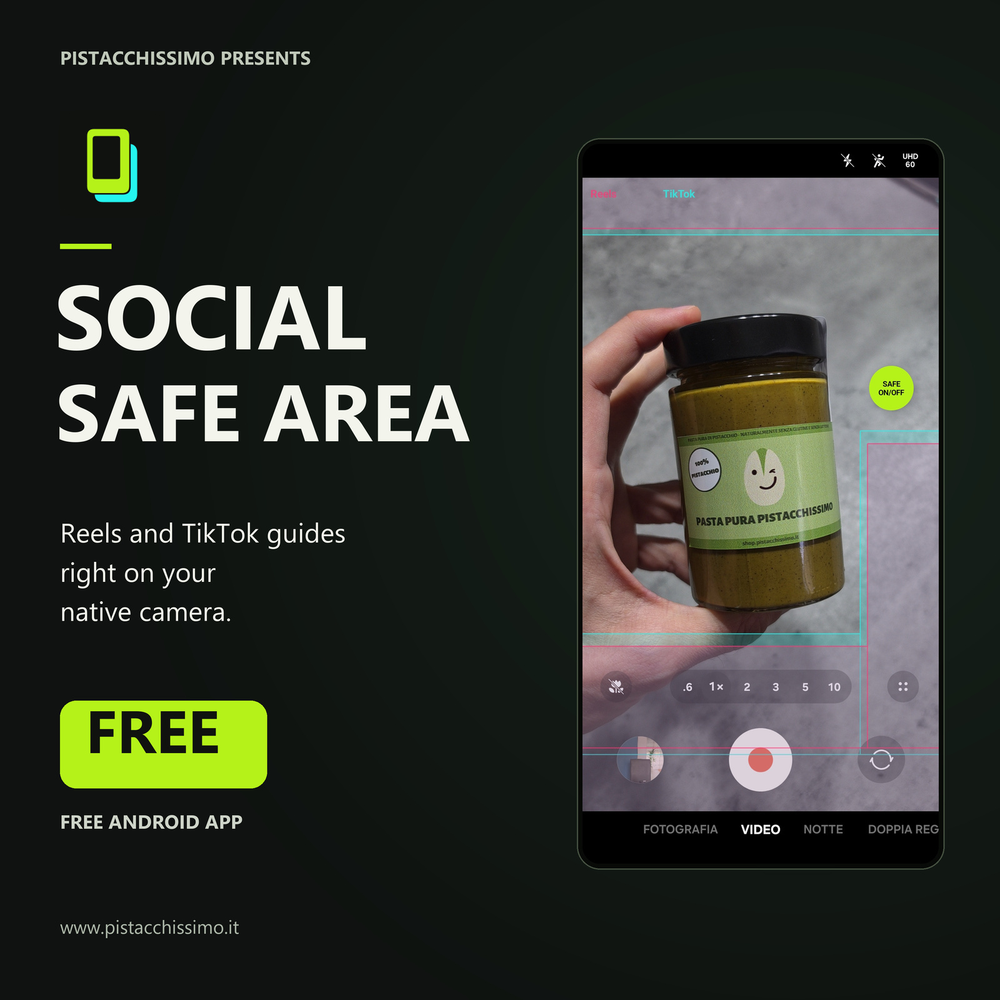

# Social Safe Area — Camera overlay for Reels and TikTok

[English](README.md) · [Italiano](README.it.md)



A lightweight Android overlay that helps you keep faces, captions and important details clear of the interface elements in Instagram Reels and TikTok.

**v1.4.0 · Android 8.0+ (API 26) · GPL-3.0-only**

The app appears as **Safe Area** on your phone. The prepared Google Play title is
**Safe Area: Reels & TikTok**; Google Play distribution is not available yet.

[](https://github.com/MarcorOnline/SocialSafeArea/releases/download/v1.4.0/Social-Safe-Area-1.4.0.apk)

**No compilation needed:** download the signed APK, open it on your phone and follow Android's installation prompts. See [release notes and checksums](https://github.com/MarcorOnline/SocialSafeArea/releases/tag/v1.4.0).

The app draws a transparent guide over your existing camera app. It does not record video, replace the camera or modify the recorded file. The guide is visible on the phone screen; it is not burned into camera recordings.

## Why I made it

I'm Marco Rinaldi, the creator of [Pistacchissimo](https://www.pistacchissimo.it/). Social Safe Area grew out of my own needs when filming content for Pistacchissimo. I chose to make it free and open source to share it with the community.

If the app is useful to you, you can support my work by [following @pistacchissimo on Instagram](https://www.instagram.com/pistacchissimo/) or [exploring the Pistacchissimo shop](https://shop.pistacchissimo.it/).

## Features

- Three independent, saved checkboxes: **Reel** (pink), **TikTok** (turquoise) and **Subtitles** (blue). Only Reel and TikTok are enabled on first install; all masks can also be switched off.
- A subtitle rectangle centred on the screen, initially just above the lower TikTok band. It shares the guides’ opacity and general alignment, with an additional saved vertical adjustment from −720 to +720 dp to move just the box, including towards the top.
- Reference-shaped unsafe bands at the top, bottom and lower right; the useful composition area stays clear.
- A small, draggable **quick button** marked `SAFE / ON/OFF`, with its position saved between sessions.
- Mask opacity from 8% to 70%, defaulting to 23%.
- Device/Android/camera profiles with proximity matching, plus manual vertical alignment from −360 to +360 dp. **Reset** restores the suggested profile.
- Optional automatic display when a selected app opens, and automatic hiding when you switch to another app or the launcher.
- From v1.1.0: a weekly update check when opening the app, with a quiet inline link when a newer release is available.
- Tap-through guide: camera controls remain usable.
- Native Android views and services, with no third-party runtime libraries, account, ads or analytics.

The interface supports **English (default/fallback), Italian, French, Spanish and German**. It follows the device language; Android 13+ also provides a per-app language choice in system settings. The bottom **ⓘ** button opens creator attribution, the app's origin at Pistacchissimo and its blog article, the @pistacchissimo and personal Instagram profiles, project source, the GPLv3 notice and calibration details.

## Getting started

Download the APK using **Download the Android APK** above. Android may ask you to allow installation from your browser or file manager; grant that permission for the source you are using, then open the APK. You can also build it yourself using the instructions below.

### Allow display on top of the camera

Open **Safe Area**, then tap **Show quick button**. On Android's permission page, select Safe Area and enable **Display over other apps** / **Appear on top**, then return to the app. On Samsung, the same switch is available under **Settings → Apps → Special access → Appear on top**; wording can vary by Android version. Published builds before v1.1.0 use the label Social Safe Area.

This permission is required to draw over your camera. Accessibility is a separate, optional permission.

Settings are grouped in **Customize mask**, **Automatic opening** and **Experimental features**, all initially closed: opening one section closes the previous one. **Show quick button** stays available at the top.

1. Open **Customize mask** and turn the **Reel**, **TikTok** and **Subtitles** checkboxes on or off as needed.
2. Adjust **Mask opacity** and **General vertical position**, if needed. Its **Reset** restores the detected profile's default alignment. **Subtitles vertical position** moves just the subtitle box relative to that general position; its **Reset** returns the additional offset to zero. The subtitle slider and its Reset are disabled when **Subtitles** is unchecked, keeping the saved position for next time.
3. Tap **Show quick button**. This action only shows the button; repeated taps do not change the mask's ON/OFF state.
4. Use the floating `SAFE / ON/OFF` button to turn the mask on or off. Only this button changes that state.
5. Drag the quick button to reposition it. Drag it onto the bottom trash target to close the overlay.

Opening Safe Area also restores the quick button when overlay permission is already granted. Mask choice, opacity, vertical alignment, quick-button position and ON/OFF state are stored locally.

### Automatically follow your camera app

1. Open **Automatic opening** and, in **Show quick button when I open**, select your camera app.
2. Tap **Enable camera detection** to open Android Accessibility settings.
3. Find **Safe Area camera detection** under installed/downloaded apps or services, switch it on and confirm Android's prompt.
4. Return to Safe Area, then open the selected camera.

If Android blocks Accessibility for a sideloaded app, its **App info → ⋮ → Allow restricted settings** option may need to be enabled first. Only do this for a build you trust; see [Android's explanation of restricted settings](https://support.google.com/android/answer/12623953). Menu names depend on the OS and manufacturer.

Opening the selected app shows the quick button and restores the saved mask state. Switching to another app or the launcher hides both the button and the mask. Returning to the selected app restores them without changing ON/OFF.

Closing the overlay explicitly using the trash target or the notification's **Close app** action suspends automatic reopening until you reopen Safe Area. Select **No app** to disable automatic following.

Detection uses full-screen window-change events. Partial popups and panels do not count as leaving the camera. Window contents are not read while experimental mode detection is off.

### Show the mask only in Video mode (experimental)

Under **Experimental features**, **Show the mask only in "Video" mode** is off by default.
The adjacent **?** explains how it works and which controls it accesses before
enabling it. It requires camera detection and an exact compatible profile. The
initial profile supports Samsung Camera in Italian, English, French, Spanish and
German, in portrait, on the device
and camera version listed in the profiles.

The feature reads the selected camera's accessible controls locally after UI
events, without screenshots or periodic polling. Photo hides the guide but
keeps the quick button; Video restores the manual ON/OFF choice. Unrecognized
modes fall back to manual control after a short transition grace period. No
control text is stored or transmitted, and the saved manual choice is never
overwritten. Camera language, orientation and updates can affect recognition.
See the [profile format](docs/camera-profiles.md#experimental-camera-mode-detection).

### Notifications

While the overlay is running, it uses an Android foreground service and prepares a notification with a **Close app** action.

On Android 13 and later, the app does not request notification permission, so this notification may be absent from the notification drawer. The foreground service can still run and appears in Android's active-apps controls. See [Android's notification-permission documentation](https://developer.android.com/develop/ui/views/notifications/notification-permission).

## Compatibility and current limits

Android 8.0 or newer is required. The app has been verified on a **Samsung Galaxy S26 Ultra (SM-S948B), Android 17 / API 37, Samsung Camera 17.0.00.43**, in portrait mode, with a **9:16** camera preview.

The default reference is a 1080 × 2340 display with the actual video preview at `x=0…1080, y=184…2104`: a 1080 × 1920 frame. The mask is scaled uniformly, and Android window offsets are accounted for when drawing. Density is used for controls and the manual vertical adjustment.

Other devices, camera layouts, aspect ratios and display settings may require vertical adjustment, even when a nearby profile is suggested. The guide stays fixed to the physical display when Android rotates, preserving its scale and saved vertical alignment. It does not automatically locate the camera preview, calibrate its width/height or provide a separate landscape-video layout. Android or individual apps can also restrict overlays on protected screens.

The mask is a composition aid based on a fixed reference, not an official guarantee of safe placement. Reels and TikTok interfaces can vary. The project is independent and is not affiliated with Samsung, Instagram, Meta or TikTok.

## Help improve camera alignment

The most useful community contribution is a **correct vertical mask offset for widely used camera apps**, tested on a real device.

Profiles live in one small file: [`camera-profiles.json`](app/src/main/assets/camera-profiles.json). Each entry records manufacturer, model, Android API, camera package/version and offset in dp. Calibrate with the slider, then open **ⓘ → Copy calibration JSON** and submit the entry in a pull request to **`develop`**.

On startup the app detects the device, OS and selected camera (or default video camera). It suggests the closest usable profile: same model first, then nearest Android API, then camera app/version. If the model is unknown it searches the same manufacturer; an unknown manufacturer uses the **first valid profile** as the default. Equal scores preserve file order.

Manual adjustments always take priority and survive restarts and app updates. **Reset** removes the manual override and returns to the current suggestion. Missing device metadata, invalid entries and unreadable/empty profile data fall back safely, ultimately to 0 dp; detection failures do not stop the guide from opening.

See [the profile format and matching rules](docs/camera-profiles.md) for examples, priority details and testing instructions. Profiles are bundled offline: a merged contribution becomes available in the next app build.

## Privacy and permissions

From v1.1.0, the app uses Internet permission to request GitHub's latest stable release when opening the control screen, at most once every seven days (including failed attempts). It sends no device identifiers, calibration data, account or installed version. GitHub and its network providers see normal connection metadata such as the client's IP address. Earlier published versions have no network permission.

A newer release appears as an inline **View update** button, which opens GitHub only when tapped. There are no update popups, notifications, automatic downloads or scheduled background requests. Offline, 404, GitHub rate limits and malformed responses do not interrupt the app. See [update behavior and release instructions](docs/app-updates.md).

Preferences and the last valid update result stay on the device; Android backup is disabled. Profile detection uses model/OS/app metadata, not serial numbers or unique device identifiers. The calibration-copy action only writes that JSON to your clipboard; external links open your browser.

| Permission / service | Purpose |
| --- | --- |
| Internet (from v1.1.0) | Check the latest stable GitHub release over HTTPS, at most weekly when opening the app. |
| Display over other apps | Draw the guide and quick button above the camera. |
| Foreground service (`specialUse` on recent Android versions) | Keep the overlay running while another app is in front. |
| Accessibility service, optional and user-enabled | Follow the selected app through window events. Only with experimental mode detection enabled and a compatible profile, also read accessible camera controls to distinguish Video and Photo. Node retrieval capability is declared to Android but unused while the experiment is off. |

No camera, microphone, media-library or storage permission is requested. Camera recordings remain the responsibility of the camera app you choose.

## Build from source

Use Android Studio, or a command-line installation with:

- JDK 21 (the version used for verification).
- Android SDK Platform 35, Build Tools and Platform Tools.
- Gradle 8.9 via the included wrapper; Android Gradle Plugin 8.7.3.

Clone the repository:

```sh
git clone https://github.com/MarcorOnline/SocialSafeArea.git
cd SocialSafeArea
```

Set `JAVA_HOME` to your JDK and `ANDROID_HOME` to your Android SDK directory. Alternatively, let Android Studio create an untracked `local.properties` containing `sdk.dir=...`.

On Windows / PowerShell:

```powershell
.\gradlew.bat :app:assembleDebug :app:lintDebug
```

On Linux / macOS:

```sh
./gradlew :app:assembleDebug :app:lintDebug
```

The first build downloads Gradle and build dependencies. The debug APK is generated at:

```text
app/build/outputs/apk/debug/app-debug.apk
```

With USB debugging enabled and the phone authorized:

```sh
adb install -r app/build/outputs/apk/debug/app-debug.apk
```

### Release signing

The downloadable APK is a **non-debug release build**, signed with a dedicated distribution key. Locally compiled debug builds use a different Android debug key. Android cannot update one with the other: migrating from a developer/debug installation to the public APK requires uninstalling the old build first, which removes its saved settings.

On Windows / PowerShell, maintainers can build and sign a release with:

```powershell
./scripts/build-release.ps1
```

The first run generates a private key under ignored `.signing/`; its password is protected with Windows DPAPI for the current Windows account. Preserve the key and credentials securely for future updates. They are not portable to a different Windows account without exporting the password on the original account. The script never commits them. Signed output is `release-artifacts/Social-Safe-Area-<version>.apk`, also ignored by Git.

The release page provides a SHA-256 checksum and GitHub's source archive for the corresponding tag.

## Verification

Build and install the instrumentation APK:

```sh
./gradlew :app:assembleDebug :app:assembleDebugAndroidTest :app:lintDebug
adb install -r app/build/outputs/apk/debug/app-debug.apk
adb install -r app/build/outputs/apk/androidTest/debug/app-debug-androidTest.apk
adb shell am instrument -w it.pistacchissimo.socialoverlay.test/it.pistacchissimo.socialoverlay.GuideRenderTest
adb shell am instrument -w it.pistacchissimo.socialoverlay.test/it.pistacchissimo.socialoverlay.GuideRotationTest
```

On Windows, use `.\gradlew.bat` instead of `./gradlew`.

The instrumentation test requires overlay permission and the reference **1080 × 2340** display. It checks the actual overlay-window origin, 9:16 geometry, transparent margins, reversed-L boundaries, mask transparency and the home button's idempotent behavior. It also checks profile proximity/fallbacks, preservation of manual settings, five translations plus English fallback, Reset and the creator-attribution page. Its output includes `PASS` or `FAIL`.

Instrumentation can leave the already-enabled Accessibility service disconnected on the reference Samsung device. Reinstall the app APK and reopen Social Safe Area after the test to reconnect it before testing automatic following.

The rotation test requires the reference display to be awake and unlocked. It compares mask pixels in physical panel coordinates at 0°, 90°, 180° and 270°, including a manual vertical offset, then restores the saved preferences and rotation policy.

For a connected Samsung device with **Camera** selected and Accessibility enabled:

```powershell
./scripts/verify-device.ps1 -Serial DEVICE_SERIAL
```

Pass `-Adb PATH_TO_ADB` if `adb` is not on your PATH. This PowerShell check verifies the Accessibility connection, two Camera/launcher transitions and preservation of the mask's ON/OFF setting. Keep the phone unlocked during the check.

## Contributing

Use **`develop` as the base branch for pull requests**. `main` holds published snapshots; `develop` is the integration branch for ongoing work. Both start from the same squashed initial snapshot.

See [CONTRIBUTING.md](CONTRIBUTING.md) for the workflow and checks. Report reproducible issues through [GitHub Issues](https://github.com/MarcorOnline/SocialSafeArea/issues), including Android version, device, camera app, preview ratio and steps to reproduce. Remove personal information from screenshots and logs.

## License

Copyright (C) 2026 Marco Rinaldi (MarcorOnline).

Social Safe Area is free software: you can redistribute it and/or modify it under the terms of the **GNU General Public License, version 3 only**, as published by the Free Software Foundation (`GPL-3.0-only`).

This program is distributed in the hope that it will be useful, but **WITHOUT ANY WARRANTY**; without even the implied warranty of MERCHANTABILITY or FITNESS FOR A PARTICULAR PURPOSE. See [LICENSE](LICENSE) for the full terms.

The Gradle Wrapper is third-party build tooling under the Apache License 2.0 and retains its original notices. See [THIRD_PARTY_NOTICES.md](THIRD_PARTY_NOTICES.md).

Android is a trademark of Google LLC. The Android robot is reproduced from work created and shared by Google and used according to the [Creative Commons Attribution 3.0 License](https://creativecommons.org/licenses/by/3.0/); this is not an endorsement.
